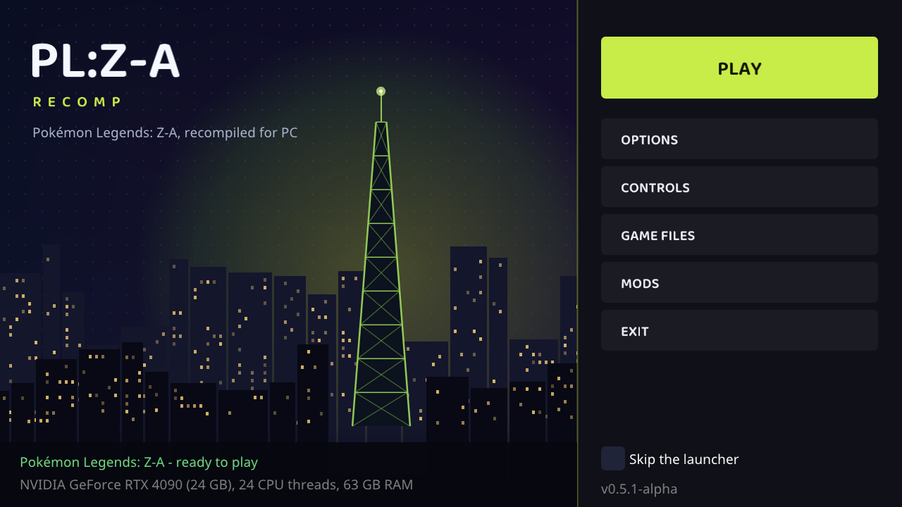

# PL:Z-A Recomp (LZ&A Recomp, branch `LegendsZA`)

A native PC port of **Pokémon Legends: Z-A** (Nintendo Switch, update 0.6.0) by **static recompilation**: the game's
ARM64 code is translated to C and compiled into a regular Windows or Linux program, with a runtime standing in for
the Switch's operating system (kernel, system services, NVN graphics on Vulkan, audio, controllers).

LZ&A Recomp has one branch per game:

- **`LegendsA`**: Pokémon Legends: Arceus (PL:A Recomp)
- **`LegendsZA`** (this branch): Pokémon Legends: Z-A (PL:Z-A Recomp)

> **No game files are included, and none ever will be.** You need your own dump of the game and its update. Nothing
> derived from the game (game code, recompiled or not, assets, keys) is in this repository or its releases.

> This project was made largely with AI (Anthropic's Claude, through Claude Code), directed and tested by a human.



## Playing on Windows

1. Download `LZA-Recomp-ZA-windows.zip` from the [releases](../../releases) and unzip it somewhere you can write to
   (not Program Files).
2. Get your game's `exefs` and `romfs` folders (below).
3. Run `ZARecomp.exe` (not code-signed: "More info" -> "Run anyway" if Windows asks), click **Select game folder...**
   and pick the folder that holds `exefs` and `romfs`.
4. Wait while the game files are copied and the game code is generated and compiled for your PC. This happens once,
   and takes from several minutes on a big CPU to much longer on a small one.
5. Click **Play**. The first start also prepares the shaders once (a progress bar).

Requirements: Windows 10/11 64-bit, a CPU with AVX2 (Intel 2013+ / AMD Zen+), a GPU with Vulkan 1.3 and a current
driver, ~25 GB free disk space during setup.

## Playing on Linux

One line in a terminal (Arch / Manjaro / EndeavourOS, Debian 13+ / Ubuntu 25.04+ and their derivatives, Fedora): it
downloads this branch, installs what it needs (asks for your password only if something is missing), builds the
program and starts it.

```sh
git clone -b LegendsZA https://github.com/MrWifi1143/LZA-Recomp.git PLZA-Recomp && cd PLZA-Recomp && ./tools/linux/install.sh && ./play.sh
```

On the start screen click **Select game folder...** and pick the folder with your extracted `exefs` and `romfs`
(below); the game code is built for your PC once. Later, start it again with `./play.sh` in that folder. To update:
`git pull && ./tools/linux/install.sh`.

The repository is private for now: you need access to it (`gh auth login`, or a GitHub token as the password).

Requirements: x86-64 with AVX2, a GPU with a Vulkan 1.3 driver (Mesa or NVIDIA), ~25 GB free during setup.

## Getting `exefs` and `romfs`

The recomp reads the game's **extracted** files: an `exefs` folder (`main`, `sdk`, `main.npdm`) and a `romfs` folder
(with `arc/data.trpfs`). It does not open `.nsp` / `.xci` files and never needs your keys: the keys are only used by
the tool you extract with.

What you need, all from your own Switch:

- the base game and the **0.6.0 update**, dumped as `.nsp` (or `.xci` for the game card)
- `prod.keys` and `title.keys` (dumped with Lockpick_RCM)

The extracted files must have the update applied: the recomp is made for 0.6.0 and other versions won't work.
Z-A's update is a patch on top of the base game's RomFS, which plain `hactool` can't apply. Use
[hac2l](https://github.com/Atmosphere-NX/hac2l) or [hactoolnet](https://github.com/Thealexbarney/LibHac/releases):

1. Unpack both `.nsp` files (they are plain archives), e.g. `hactoolnet -t pfs0 base.nsp --outdir base` and the same
   for the update. In each, the **program NCA** is the biggest `.nca` file.
2. Extract the update on top of the base game:

   ```sh
   hac2l -k prod.keys --titlekeys=title.keys --basenca=base/<base program>.nca \
         --exefsdir=game/exefs --romfsdir=game/romfs update/<update program>.nca
   ```

   (`hactoolnet` takes the same `--basenca`, `--exefsdir` and `--romfsdir` options.) If the update's title key is not
   in your `title.keys` yet, it is in the update's `.tik` file: rights ID at offset 0x2A0, key at 0x180.
3. Pick the `game` folder on the start screen.

## Status

Playable through the opening into Lumiose City: boot, character creation, the intro, the station, Lumiose free roam.
Tested on Linux with an RTX 4090; the Windows build is tested under Wine.

- Frame rates: 30 (the game's own), 60, 120 or 144 fps, with the game and its UI at the right speed.
- Graphics: GPU-culled and instanced props (station facade, iron work, trees, hedges, lamp posts), cast shadows,
  render scale up to 4K, SMAA.
- NPCs animate every frame (the game's own animation level of detail is bypassed).
- Start screen: resolution, fullscreen, anti-aliasing, frame rate, FPS counter, button prompts, mods, controller test
  and remapping, keyboard remapping.
- Button prompts for what you play with: the bound keys and mouse buttons, Xbox letters or PlayStation shapes instead
  of the Switch's (Auto follows the last used keyboard / mouse or controller, even when it changes while playing;
  remapped buttons show their new button).
- Keyboard and mouse: WASD (Left Ctrl walks), mouse camera (click to take the mouse, Esc lets it go), mouse buttons
  and wheel bindable like keys. The game's menus work with the keyboard; clicking them with the mouse isn't possible.

Known issues:

- Lumiose free roam runs about 105 fps at the 144 target on an RTX 4090 PC (limited by the game's own CPU work).
- Indirect compute dispatches are not implemented yet.
- Running legs: the BipedIK foot lock is worked around (`runtime/hle/za_fixes.c`); its root cause is still open.
- On a fresh install, shaders and pipelines compile the first time they are seen (short stutters).
- Expect other missing effects and bugs.

## Building from source (Linux, by hand)

What the script does, step by step. Requirements: clang + lld, SDL 3, FFmpeg, shaderc, the Vulkan loader, Python 3.

```sh
python3 -m venv .venv && .venv/bin/pip install lz4 capstone unicorn
make -j$(nproc) all SHADERC=-lshaderc_shared  # build/lasrecomp (Debian / Ubuntu: SHADERC=-lshaderc)
mkdir -p extracted && ./play.sh               # the start screen sets up your game files and builds the game code
```

For development, with the game code built by the Makefile instead: your own game files in extracted/exefs
(main, sdk, main.npdm) and extracted/romfs, then

```sh
make gen                                      # translate the game code into generated/
make -j$(nproc) all SHADERC=-lshaderc_shared  # build/lasrecomp + build/lasgame.so
cc -O2 -Iruntime tools/romfs/mkromfs.c runtime/romfs_build.c -o build/mkromfs
./build/mkromfs extracted/romfs extracted/romfs.bin
./play.sh                                     # start screen, then the game (--play skips it)
```

`SHADERC=-lshaderc_shared` is for distributions that ship only the shared shaderc library, such as Arch.

The Windows release is cross-built from Linux with zig: see `tools/windows/README.md`.

Never commit or share `extracted/`, `generated/`, `build/` (the built game library is recompiled game code), `save/`
or anything else that comes from the game. See `CONTRIBUTING.md`.

## Credits and license

Built on [letsgo-recomp](https://github.com/raulzrrs/letsgo-recomp) (Pokémon: Let's Go) by raulzrrs, itself a fork of
[LAS Recomp](https://github.com/peiikai/LASRecomp) (Link's Awakening) by Peiikai. MIT licensed: `LICENSE` and
`LICENSE-LASRecomp`. Third-party components keep their own licenses: `THIRD-PARTY-NOTICES.md`.

Pokémon Legends: Z-A is © Nintendo / Creatures Inc. / GAME FREAK inc. / The Pokémon Company. This project is not
affiliated with or endorsed by them.
